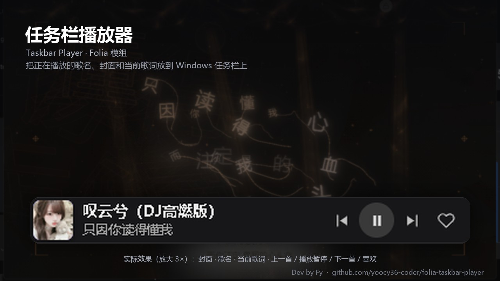

# 任务栏播放器 · Taskbar Player

给 [Folia](https://github.com/chthollyphile/folia-major) 加一个叠在 **Windows 任务栏**上的迷你播放器：封面、歌名、当前歌词，加上上一首 / 播放暂停 / 下一首 / 喜欢四个按钮。样式和汽水音乐的任务栏控制器类似，挂在任务栏右端，播放时跟随 Folia 的歌曲和歌词实时更新。



## 功能

- 任务栏上的迷你控制器：封面、歌名、当前歌词（可选显示）、播放控制与喜欢。
- 点击封面或歌名会唤起 Folia 主窗口；点喜欢等于按 Folia 播放器里的喜欢按钮。
- 跟随 Folia 的播放状态：切歌、暂停、歌词换行都会更新；暂停时可以选择自动隐藏。
- 可调宽度、距屏幕右边缘的距离、垂直微调、不透明度、歌词偏移，适配不同的缩放和任务栏位置。
- 提供一个可配置全局快捷键的命令「显示 / 隐藏任务栏播放器」（设置 → 快捷操作 → 全局快捷键）。

## 安装

需要 **Folia 桌面版，版本 0.7.20 及以上**，并且已打开「设置 → 模组 → 模组系统」。

1. 下载本仓库的 zip（或 release 里的 zip）。
2. 打开 Folia 的「设置 → 模组」，把 zip 拖进模组面板；也可以解压后把 `taskbar-player` 文件夹放进 `%APPDATA%\Folia\mods`。
3. 在模组面板里启用「任务栏播放器」，确认弹窗后生效。首次启用会显示「未验证」，因为社区模组没有 Folium 官方签名。
4. 播放任意歌曲，任务栏右端就会出现控制器。

## 设置

在「设置 → 模组 → 任务栏播放器」里展开该模组：

| 设置 | 说明 |
| --- | --- |
| 启用任务栏控制器 | 关闭后不创建窗口 |
| 显示当前歌词 | 第二行显示当前歌词；关闭后显示歌手 |
| 暂停时隐藏 | 暂停或停止时把控制器藏起来 |
| 宽度 | 控制器宽度（默认 380） |
| 距屏幕右边缘 | 距离屏幕右边缘的像素（默认 300，避开系统托盘） |
| 垂直微调 | 上下微调几个像素，适配不同任务栏高度 |
| 不透明度 | 背景不透明度 |
| 歌词偏移（毫秒） | 个别歌词比音频早/晚时手动校正 |

设置保存在模组自己的数据里（`api.storage`），重装模组不会丢；「设置 → 模组」里也能清空模组的缓存。

## 实现

- **主进程入口（`index.cjs`）**：用 Electron 建一个无边框、透明、`alwaysOnTop`（`screen-saver` 层级）、`skipTaskbar`、`focusable: false` 的 `BrowserWindow`，按 `screen` 的 `workArea` 算出任务栏区域并贴上去；每 250ms 读一次宿主的 `api.runtime.getPlaybackSnapshot()`，从 `lines` 里按播放位置挑出当前歌词，把视图通过 IPC 推给页面。窗口本身加载的是模组目录里的本地 HTML，开了 `sandbox`、`contextIsolation`，没有 `nodeIntegration`，也不加载任何远程页面或脚本。
- **渲染端（`client.mjs`）**：用 `folium.omni.describeSong()` 拿封面地址、`folium.playback.getState()` 拿喜欢状态，通过 `folium.rpc` 传给主进程；控制器窗口发出的播放/切歌/喜欢命令经由 `folium.rpc.on('command')` 交给 `folium.playback` 执行。设置面板用 `settingsSections` + 自定义 `settingsPanel` 渲染。
- 模组不联网、不上传任何数据；封面图由 Folia 自己的进程加载（`https` 或 `folia-cover:`）。

## 兼容性

- 只支持 **Windows 桌面版 Folia**：用的是「叠在任务栏上的窗口」这个做法，macOS / Linux 上模组会直接不工作（不会报错）。
- 在 Windows 11 上任务栏默认居中/靠左都可以；如果任务栏在屏幕顶部，控制器会贴到顶部；自动隐藏任务栏时退化为工作区右下角。
- 高 DPI 下位置按 DIP 计算；如果对不齐，用「垂直微调」和「距屏幕右边缘」。

## 权限

| 权限 | 用途 |
| --- | --- |
| `playback.read` | 主进程读取正在播放的歌曲、进度和歌词（`api.runtime.getPlaybackSnapshot`） |
| `playback.control` | 执行任务栏上的播放 / 暂停、上一首、下一首、喜欢 |
| `filesystem.data` | 把窗口位置、宽度等设置存在模组自己的数据目录里 |

## 开发

模组目录就是本仓库根目录：

```
mod.json       清单（main + client 双入口）
index.cjs      主进程：窗口、任务栏定位、播放快照、设置持久化
client.mjs     渲染端：封面/喜欢、命令、设置面板
preload.cjs    控制器窗口的隔离桥
controller.html / controller.js   控制器页面
preview.jpg    模组市场介绍图 (1280×720)
```

本地调试：把仓库放进 `%APPDATA%\Folia\mods\taskbar-player`，在 Folia「设置 → 模组」里重载并启用；改了文件后需要重新确认（内容摘要变了）。主进程里的报错会出现在模组面板该模组的展开行。

## 许可证

MIT，见 [LICENSE](LICENSE)。

## 更新日志

### 0.1.1

- 窗口改为可激活窗口：修复用 QQ 截图 / 截图工具截完图后，控制器按钮点了没反应的问题（此前 Windows 在该场景下只送 `mouseup` 不送 `mousedown`）。
- 外部原因导致窗口被隐藏、或页面被完整遮挡后恢复时，自动销毁并重建控制器窗口。
- 进全屏时隐藏控制器，退出全屏后自动重建；主窗口尺寸变化时也会重建，避免残留的输入状态。
- 点封面 / 歌名打开 Folia 主窗口时更可靠地抢到前台。
- 任务栏置顶每 1.2 秒重新确认一次，被其它置顶窗口压住会自动回来。

### 0.1.0

- 第一个版本：任务栏迷你播放器，封面 / 歌名 / 当前歌词 / 上一首 / 播放暂停 / 下一首 / 喜欢。

## 作者与反馈

Dev by **Fy**（[@yoocy36-coder](https://github.com/yoocy36-coder)）。

用着有问题、想加功能，欢迎到 [本仓库的 issue](https://github.com/yoocy36-coder/folia-taskbar-player/issues) 提，附上 Folia 版本、Windows 版本和复现步骤，方便定位。
