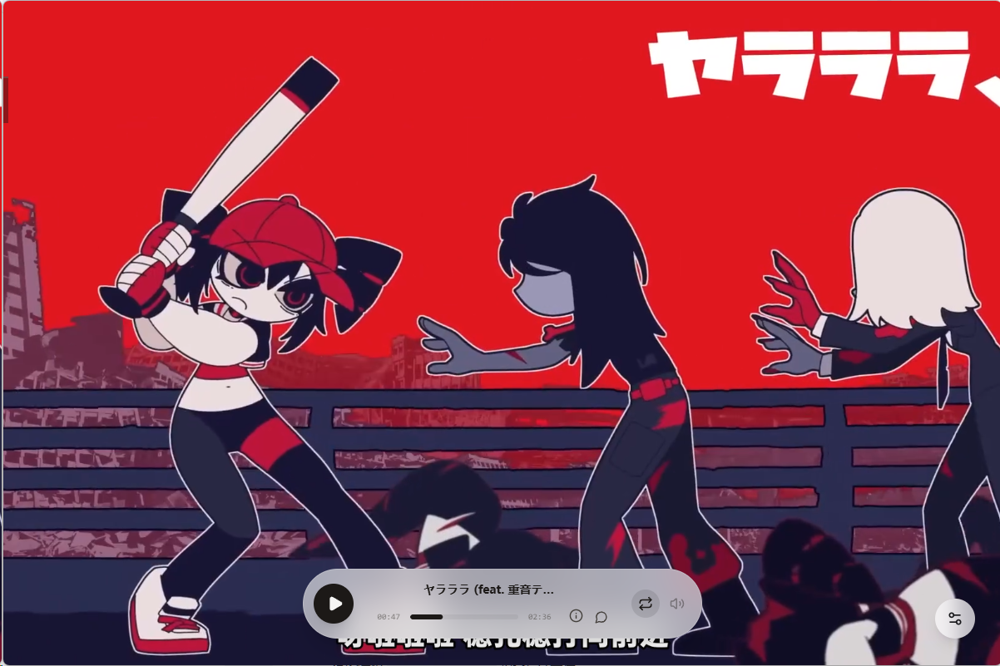
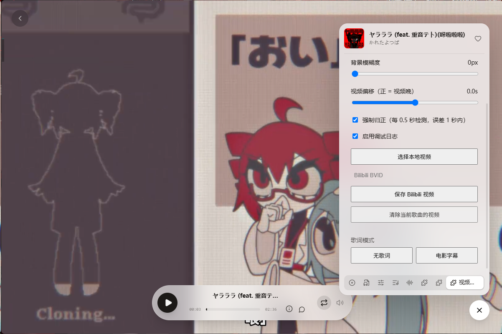

# 视频背景（video-background）

为 Folia 播放页添加视频背景：每首歌可以单独配置本地视频或 Bilibili 视频，并支持音画同步、背景模糊、无歌词与电影字幕模式。

## 功能

- **歌曲级视频映射**：为不同歌曲分别绑定本地视频或 Bilibili BVID，配置持久化保存
- **音画同步**：本地视频跟随音乐进度对齐；视频比音乐长时按偏移量对齐，比音乐短时自动循环
- **强制归正**：开启后每 0.5 秒检测一次，偏差超过 1 秒立即拉回
- **视频偏移**：类似歌词延迟调节，正值让视频晚于音乐，范围 -10 ~ +10 秒
- **背景模糊**：0–30px 可调，实时生效，方便看清歌词
- **无歌词模式**：隐藏歌词与封面，只保留视频背景
- **电影字幕模式**：在播放控制栏上方以主题色显示无动画字幕

## 使用

1. 播放任意歌曲
2. 打开播放页面板中的「视频背景」标签页
3. 为当前歌曲选择本地视频，或输入 Bilibili BVID 后保存
4. 按需调整模糊度、视频偏移，或打开「强制归正」

歌词模式可在面板底部一键切换。

## 权限说明

| 权限 | 用途 |
| :--- | :--- |
| `filesystem.data` | 保存歌曲与视频的映射、模糊度等设置 |
| `net.embed` | 嵌入 Bilibili 播放器 iframe |
| `visualizer.mode` | 在面板中切换无歌词 / 电影字幕模式 |

## 已知限制

- **Bilibili 视频不支持精确同步**：iframe 无法读写播放进度，只能做到"加载即背景"，拖动进度条时不会跟随
- 部分 B 站视频因 UP 主设置或版权原因不允许嵌入，遇到黑屏请更换视频源
- 仅支持 Folia 桌面版

## 调试

面板中可开启「调试日志」，日志写入：
%APPDATA%\Folia\mods-data\video-background\files\debug.log
