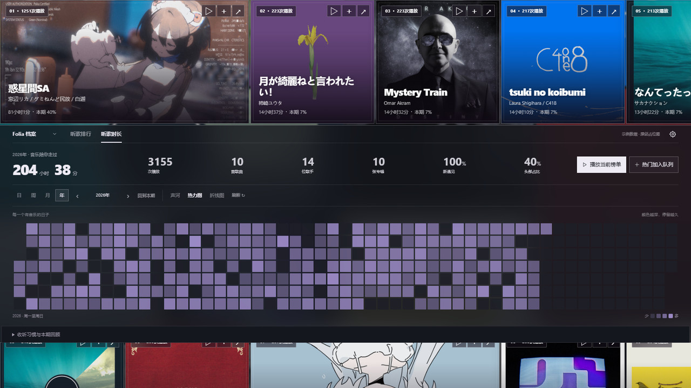

# 听歌档案 · Folium 模组

记录 Folia 本机播放：歌曲／歌手／专辑排行、累计时长、声河、热力图、折线图、单曲轨迹与备份。封面画布支持拖动与聚焦，适配深浅主题和低性能模式。

v1.3.3 恢复网易云档案，使用 Folia 官方账号接口与实验性 `platform.raw`。仅申请网易云读取权限，凭据始终由宿主管理。`platform.raw` 的返回结构不作稳定性保证，后续 Folia 更新可能影响云端功能。

兼容声明：本版本需要 Folia >=0.7.22（Folium 1.7）。清单声明 `folia: ">=0.7.22"`，客户端继续检查 Folium major=1、minor>=7。Folia v0.7.22 已于 2026-10-23 正式发布，包含本版使用的账号接口与实验性平台读取接口。旧宿主请继续使用已签名的 v1.2.4。实验能力的兼容范围以实际宿主为准；验证记录见源码仓库 VALIDATION.md。

源码：[GitHub](https://github.com/imicola/folia-listening-archive) · [版本下载](https://github.com/imicola/folia-listening-archive/releases)



## 实验功能说明

网易云档案依赖宿主提供的实验接口。GitHub Release 标记、模组市场渠道与宿主签名是三个独立状态，安装时以宿主显示和市场记录为准。实验接口可能改变；发生结构变化时保留明确的错误或未知值，不把缺失数据当作零。市场渠道由维护者按当次规则审查决定，本模组可接受先行测试渠道。

## 安装

1. 在 Folia「设置 → 模组」开启模组系统。
2. 安装 `listening-archive-v1.3.3.zip`；若没有 ZIP 安装入口，将包内 `listening-archive` 文件夹完整解压至模组目录，再重载。
3. 启用模组并确认权限；从首页或命令台打开「听歌档案」。

更新前先导出本机记录，并在退出 Folia 后备份 `mods-data/listening-archive`。完整替换模组程序目录，保留数据目录，再重新确认权限；勿同时启用相同 id 的副本。旧网易云自用版缓存会重置，需要重新同步；已核对的主时长字段使用默认单位，仍可在设置中手动调整。本机记录保留。首次启用前不会回填本机历史。

## 使用

- **听歌排行**：歌曲／歌手／专辑筛选、排序、搜索；点击封面聚焦，Escape 收起，Home 回到横幅。
- **播放与排队**：「▷」和「播放当前榜单」通过公开 `playSong` 播放首个可解析项，再通过 `enqueue` 追加其余可解析项；点击单个封面上的播放按钮时优先所选歌曲。此操作不清空或替换原队列，也不自动跳转宿主拼贴。「＋」和「热门加入队列」仅追加。
- **可播放范围**：仅能解析当前歌曲或当前会话队列里仍有有效宿主句柄的歌曲。未解析项会提示数量；可先在 Folia 中播放对应歌曲或将其歌单加入队列。全部无法解析时不会修改播放或队列。
- **听歌时长**：按日／周／月／年查看声河、热力图与折线图；点击时段查看记录。
- **单曲轨迹**：累计次数与时长、最近 24 个月排名、星期和小时分布、按日期查看时间轴。
- **设置与备份**：低性能模式、导出和合并备份；支持系统减少动态偏好。

排行在打开页面、变更筛选或主动刷新时更新；关闭统计页后仍持续采集。

## 接口边界

封面仅通过公开播放页接口读取，缩小后缓存在专属目录，也可手动补充本地图片。未取得的封面显示占位。历史记录不持久化临时播放句柄；每次操作重新从公开播放状态和队列取得句柄，不读宿主数据库、不构造平台歌曲对象。

本机档案记录 Folia 实际播放的各来源歌曲；网易云档案单独保存平台快照，不合并进本机播放次数或轨迹。来源菜单切换「本机 / 网易云」，登录 Folia 后主动同步。

### 网易云读取范围与安全边界

- 稳定账号接口：`folium.account.getState('netease')` 与 `account.changed`，仅使用昵称和不透明 `accountKey`，不读取用户 ID。
- 实验接口：清单声明 `experimental: ["platform.raw"]` 与 `platform.netease.read`。只调用 `user_record`（`type: 1/0` 周榜/总榜）、`listen_data_total`（累计报告）、`listen_data_realtime_report`（`type: week/month`）。不传 uid、凭据、URL 或代理参数，不申请 write 或 net.fetch。
- 请求仅由用户点击发起，20 秒超时，可取消；返回数据超过 4 MiB 拒绝处理。宿主校验会话，模组再次核对响应账号键；退出/换号后取消旧请求、清空云端快照及单位映射，本机记录不受影响。
- 不读取宿主 localStorage、Cookie、Token、本机端口、宿主数据库或打包模块。无开发者遥测、远程代码执行或账号写入。
- 原始 JSON 的字段和单位不受 Folium 稳定契约保证。时长选择器排除时间戳、天数、次数和睡眠分项，优先列出当前周期的主时长字段；对于已与网易云原生显示核对的主字段，默认采用累计 `data.totalDuration` 的秒单位、周／月 `data.listenTimeDistributionBlock.playDuration` 的分钟单位；已有手动设置优先。其他字段或切换字段时需明确确认单位。未确认、缺失或结构变化显示未知，不用曲长乘次数估算。仅持久化处理后的榜单和过滤后的数字报告；忽略报告文本和凭据类字段。周/月为网易云统计口径。
- 云端歌曲播放沿用公开播放句柄匹配来源与原始歌曲 ID；当前会话无法解析时保留原播放/队列，外部 Stage 不允许此操作。

官方依据：[需求 #788](https://github.com/chthollyphile/folia-major/issues/788)；实现按已发布 Limo 对应提交 `f3a90708afbec884934d8bca16bbd0a35feeb6a7` 的契约与白名单核对。实验接口可能随 Folia 更新变化，失效时显示安全错误。

## 统计口径

- 实际听满 `min(30 秒, 歌曲时长的一半)` 计一次；未知时长按 30 秒门槛计次。快速略过仍保留已观测片段。
- 实际累计达到歌曲时长的 90%，按整首时长统计；提前切歌记实际片段。未知时长不推算整首。
- 暂停、拖动、长采样空档和睡眠时间不会补成听歌时长。静音播放仍记录。排除视频导出、仅展示外部歌词的场景。混音的数秒重叠不做精密计量。
- 歌曲按规范化的歌名＋歌手归并，忽略大小写、多余空格与歌手排列顺序；保留 Live 等标题标记。原始来源与专辑不变。
- 合唱分别归属每位歌手；专辑按专辑名＋主要歌手归组，每次播放保留当时专辑归属。
- 采用设备本地时间，周一为一周起点。跨午夜片段拆分；完播补足按实际片段比例分配。一次有效播放归入该次记录的开始时刻。
- “新遇见”指本期首次被**此模组**记录的歌曲占比。“头部占比”为时长最多的单曲占比，不是综合评分。

从模组启用后开始积累；不回填之前的个人听歌历史。

## 数据与备份

记录位于 Folia 用户数据下 `mods-data/listening-archive/files/`：按月的 `YYYY-MM.jsonl`、`checkpoints.json`、`settings.json` 和 `artwork/`。主进程是唯一写入者，约每 5 秒保存检查点，切歌及时结算；异常退出后恢复最后一个成功检查点。

设置中的导出将**原始听歌记录**写入「文档/Folia 听歌档案备份」。导入只补充未知记录 ID，重复导入不增加次数。单个备份导入上限 50 MiB、10 万条；封面缓存与设置不包含在记录备份中。迁移完整档案时可在退出 Folia 后一并复制专属数据目录。

权限：`filesystem.data` 用于模组专属目录；`stageLayers` 用于公开播放页封面；`playback.control` 用于用户触发的播放与排队；`platform.netease.read` 用于用户主动同步的网易云榜单与报告。导出备份会写入「文档/Folia 听歌档案备份」。不读取宿主登录凭据，不请求网易云本机服务，不向开发者发送数据。

## 开发

```text
npm ci
npm run typecheck
npm test
npm run build
npm run test:package
npm run preview
npm run package
```

预览仅绑定 `127.0.0.1:4326`，合成统计配合对应真实封面，操作不控制 Folia。Windows 打包 ZIP 内包含完整界面依赖，用户无需 Node。

验证记录和提交资料仅留在源码仓库，不随模组签名分发。
