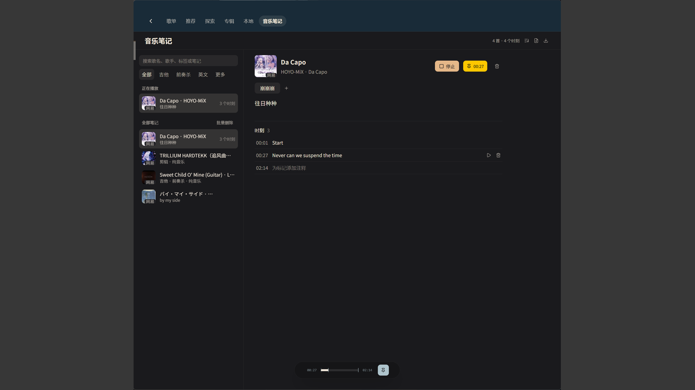

# Folia 音乐笔记

给歌曲写笔记、打标签，或用播放条上的图钉记下喜欢的时刻。歌曲在第一次记录时自动加入列表，笔记保存在本机。



## 安装与使用

1. 在 [Releases](https://github.com/setobox/folia-music-notes/releases/latest) 的 **Assets** 中下载 `music-notes-<版本>.zip`。
2. 打开 Folia 的「设置 → 模组」，将 ZIP 拖入并启用。安装目录固定为 `mods/music-notes/`，更新时把新版 ZIP 拖到同一位置，再次启用即可。支持 Folia `>=0.7.29 <0.8.0`。
3. 在首页打开「音乐笔记」，或在 Folia 前台按 `Ctrl+N`。按 `Esc` 返回资料库，打开弹窗时先关闭弹窗。在「设置 → 模组 → 音乐笔记」可启停快捷键、重新绑定，或点绑定旁的 × 清空。正文停输约 800 毫秒后自动保存，失焦、切歌或离开页面时立即尝试保存。左侧搜索支持正文、标签和时刻文字。
4. 在笔记页点「播放」开始听歌，「停止」会保留当前位置，点「继续」即可接着听。播放按钮旁的黄色图钉按钮显示当前进度，点它即可「记下这个时刻」并填写注释。也可用底部播放条的图钉，或在播放时按 `Ctrl+K` 执行「记录时刻到笔记」。点击已记录的时间即可尝试从那里播放。
5. 拖动「全部笔记」里的歌曲或标签，在虚线处松手即可调整顺序。新笔记放在最前，编辑正文会保留它的位置。新标签加在末尾，侧栏和笔记详情共用同一套标签顺序。排序会自动保存，并随笔记备份导出。

页头右侧的三个图标依次为「从歌单导入」「恢复备份（导入）」「备份（导出）」。点向下箭头可选择备份 JSON 文件，只补入缺少的歌曲。点向上箭头可将笔记导出为 JSON 文件。

导入的空笔记和清空正文后的笔记都会保留。删除单条笔记时，点击歌曲旁的垃圾桶，再点「确认删除？」。点「全部笔记」右侧的「批量删除」可逐首勾选或全选，再核对弹窗中的歌曲数量。「全选」和「取消全选」作用于当前搜索和标签筛选的全部结果，包括尚未滚动显示的歌曲。

从笔记页恢复当前暂停的歌曲时会留在原处。切换到另一首歌时，Folia 会遵循「设置 → 播放页 → 播放后进入的视图」。选择「留在原处」即可在换歌后继续看笔记。

笔记保存在当前 Folia 应用资料的 `FoliaMusicNotes` 数据库中。卸载模组后笔记仍会保留，重装后可继续使用。换设备或清除应用资料前，请先导出备份。

## 开发与打包

在仓库根目录使用 Node.js 24 和 `package.json` 指定版本的 pnpm。运行以下命令可复现发布构建和检查：

```sh
pnpm install --frozen-lockfile
pnpm run typecheck
pnpm run build
pnpm test
```

`src/core/` 实现笔记存储、标签和备份，`src/ui/` 实现笔记界面。`src/foliumCompatibility.ts` 集中了读取私人歌单和当前歌曲标识所需的宿主内部接口，升级 Folia 后需要核对这两项功能。`mod.json` 中的 `playback.control` 用于播放歌曲和跳转到书签，`ponder.targets` 用于注册使用教程。

构建脚本在 `dist/music-notes/` 生成模组文件，在 `release/` 生成可直接安装的 ZIP。压缩包包含客户端入口、清单、预览图和许可证。

## 发布

更新 `mod.json` 的版本号，提交并推送源码，再推送匹配的 `v<版本>` 标签。例如首版使用 `v1.0.0`。GitHub Actions 会检查版本、构建、运行测试，并把 ZIP 作为同名 GitHub Release 的附件发布。

GitHub Release 提供作者构建的安装包。Folium 市场的签名是独立流程，市场目前从指定 Git 提交的目录中读取已构建的文件。[市场收录规则](https://github.com/chthollyphile/folium-compound#收录第三方模组)

## 许可证

音乐笔记沿用 AGPL-3.0。设置控件、样式和 Folium 类型声明取自 [Folia](https://github.com/chthollyphile/folia-major)。第三方依赖的许可证随安装包收录在 `THIRD_PARTY_NOTICES.txt`。完整授权文本见 [LICENSE](LICENSE)。
