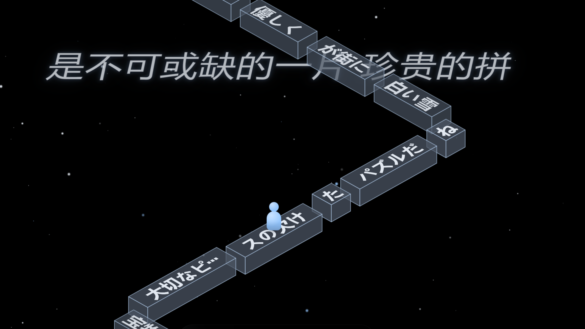

# 跳一跳（visualizer-jump）

等距场景里，一个小人在一根根带字的长方块上跳的歌词动画模组。纯渲染端（只有 `client.mjs`），
清单与接口规范见 [`mods/README.md`](../README.md)。

## 预览
建议在16:9的2560×1440分辨率下，日光主题下的中文场景截图（可以调用探针），然后对画面上下左右各裁掉 15%，保证内容饱满。

## 镜头：投影与缩放分开

「镜头」那组两根旋钮各管一件事（`jumpFrame.mjs`）：

- **俯角**（`pitch`）只改**投影的形状**：地面铺多开、柱身与小人在屏幕上多高、字的错切角度。
- **镜头距离**（`cameraDistance`）只改**缩放**：1 是参照俯角（面板默认 34°）那一版取景，
  调大 = 拉远、调小 = 推近。

以前这两件事绑在一起：格子大小是由当前俯角反解出来的，俯角一小、纵向预算一收缩，
格子就跟着放大——拖俯角滑杆时整屏在缩放。现在取景按 `min(当前俯角, 参照俯角)` 封顶：

- 俯角**往下**调不再放大画面（封顶在参照那一档，是个平台）；
- 俯角**往上**调仍然会缩一点——纵向确实铺得更开，不缩就装不下，方向单一、幅度小；
- 想要更大 / 更小的画面只动「镜头距离」，它与俯角正交。

`anchorBelowPx`（小人钉在画面从下往上的第几成）仍按**当前俯角**的预算算：那是构图，不是缩放。

「镜头距离」只缩放**场景**（柱子、小人、路）。浮在画面上的**译文不跟它走**：那一层的字号以柱顶
那块字为尺子，而尺子取的是 `referenceProjection`（距离 = 1 那一版取景），于是推近拉远只把柱子放大
缩小，译文字号纹丝不动。俯角照旧管译文——俯角压平，一格变小，这块字也跟着小一档。

## 柱顶的字：字宽

块长与字盒都由「这块字有多宽」反推（`jumpShape`）。宽由 `jumpMeasure.mjs` 拿宿主给的字体
（`palette.fontFamily` / `palette.fontWeight`，与译文那套分开）量出来，记成以字号为单位的进宽（em）。

- `span` = 量出来的进宽（em）；`glyph` 恒为一个字号（字盒的高就是字号）。
- 字盒与文字同宽：字边缘到柱子边缘的空当只由这块字有多宽决定，与语种无关。
- 不做光学字号归一化（拿墨迹高定字号）：墨迹高逐串变，字号会逐块跳变。现在的字号由柱高预算定，全屏同一个。
- 字体进 `layoutCache` 的键：换主题 / 换字体后作废重算。
- 已知取舍：字体未加载完时量到的是兜底字体的宽，且会被缓存记住。

## 译文层

柱顶的字照旧逐字跳，屏幕下方另有一层**译文**（`jumpTranslation.mjs`）：整句铺在画面中部偏下，
**不做逐字跟唱**，只在换句时淡入（`resolveTranslationReveal`）。

- **压在柱子下面**（`jumpStage` 的层序）：这一层挂在容器下、`canvas` 之前，柱子、小人、轨迹都在
  它前面。译文是浮在画面中部的注解，柱子从它前面经过，而不是被它盖住。
- **压在柱子群里，柱子可以调透**（`pillarOpacity` 正面顶面 / `pillarSideOpacity` 侧面 /
  `pillarEdgeOpacity` 棱线，三根互不连坐，默认 55% / 50% / 70%）：推到头就是一根实心柱，
  压在译文上真的挡住；调淡就变成一层玻璃，被柱面盖住的那几个字照样读得出来。
  **三根都能滑到 0**：面没了只剩棱线勾出的轮廓，棱线也没了就只剩字。
  **三根分开是为了让「不透明」这个说法在画面上成立**：以前三样共用一个 `faceAlpha`，
  乘完只剩零点几，面板写着不透明、画面上仍是一层雾。
- **其他行浓淡**（`otherRowOpacity`，默认 90%）：正在写的那一行永远是 1，上下两行乘这一档。
  以前这一档写死在代码里（而且上下两行另取一套更淡的面色），面板上没有对应的旋钮，
  三行永远差着那一截；现在它是一根旋钮，推到 100% 三行完全同色，调到 0 就只剩当前行。
- **谁盖住谁**（`client.mjs` 的 `painted` → `stage.arrange`）：绘制顺序是屏幕上更靠上的先画、
  更靠下的压在上面。这一条曾经漏了——排序只用在写柱子那一遍，交给舞台的是未排序的数组，
  于是屏幕上方那几行（更远）最后画、把近处的柱子盖住，柱子全调成不透明时一眼就能看出。
- **落地 / 起跳那圈环**（`jumpCourse` 的 `resolveLandingBurst` + `client.mjs` 的 `paintImpact`）：
  落到柱顶那一瞬铺开一圈环、溅几粒尘，从柱顶蹬开再铺一小圈（更小、更淡、不溅尘），
  两圈都按时间表里现成的那一秒算，拖动进度不会留下半开的环。
  **层序是「影子 → 环 → 小人」**：环本来铺在他落下的那一点，而影子是一团压在那一点上的暗斑，
  挂在影子下面时刚落地那几帧环还小，正好整圈藏进暗斑里——「环看不见」就是这么来的。
  环的起点半径、粗细（2px）与淡出曲线都按「在柱顶那块半透明的面上还看得清」定，
  `TAKEOFF_RING_MIN_GAP` 之内只留落地那一圈（两圈前后脚铺在同一点上会糊成一团）。
- **分行**（`wrapTranslationRows`）：一句译文按可见字逐字试宽，中文在字间断、拉丁只在词间断。
  放不下就**缩字号**重排（`buildTranslationLayout`），不再横着压——横压会让宽高比失真，
  窄屏上字会变成细长的一条。`fitTranslationLayout` 只剩保底（最多收一成多）。
- **透视三选一**（`translationPerspective`）：`off` 正对镜头 / `block` 整块一起压扁 /
  `glyph` 逐字各持一份 `matrix3d`，θ 就是「镜头」那组的俯角。
- **变形量由俯角同步给**（`resolveTranslationTiltAmount`）：变形量 = `(1 − sinθ) / (1 − sin34°)`。
  俯角大（更接近俯视）→ 变形小，这块字越来越像正对着镜头的一片；俯角小（更接近平视）→
  变形大，更扁、更歪、近大远小更深。压扁（`1 − cos34°`）、侧倾（`0.18`）、`depth` 的增益
  （`1.32`）三项都乘这一个量，所以「变形」是一个数说了算。参照俯角 34° 那一档正好等于 1，
  也就是写死变形量时的老画面；`strength: 0` 仍给恒等矩阵。
  逐字档的矩阵是换句时才写进 `span` 的，所以透视档位与变形量都进 `layout.key`。
- **位置 = 对齐 + 偏移**（`translationAlign` / `translationOffset`，默认顶部对齐）：对齐方式决定
  这块字钉在画面的哪一头、也决定它钉住自己哪一头——顶部档钉第一行的上边缘、零点在窗口上沿
  （多折出来的行往下长），居中档钉块心、零点在窗口正中，底部档钉最后一行的下边缘、零点在窗口下沿。
  偏移是**挪几个窗口高**（`TRANSLATION_OFFSET_LIMIT` = ±0.8），0 就正好贴在零点上——顶部对齐 +
  0 时第一行的上边缘压着窗口上沿，底部对齐 + 0 时最后一行的下边缘压着下沿；±0.8 够把字整个
  推出画面。没有隐藏的留白、也没有底栏当地板：画面自己的边距不再约束这个旋钮。
  `measureTranslationInk` 扣的是行盒比字高出来的那半条空白（half-leading），不扣的话字的上边缘总差着一小截。
- **旋钮**：译文显示（译文 / 罗马音 / 不显示）、字号、最多几行、排版（顶部 / 中心 / 底部对齐）、
  排版偏移、透明度（默认 80%）、透视、辉光。变形量没有单独的旋钮：它跟着「镜头」的俯角走。
  **不跟随宿主的字幕开关**——歌词特效自己给了译文，就不该再让底栏那条字幕替它转述开关；
  只有宿主说「现在根本不该有歌词」（设置窗口盖住播放页）时才一起收起。
- **辉光**（`translationGlow`）走 `text-shadow` 而不是背后垫底：光跟着字形走，柱子从字缝里看得见。
- 排版结果按「行索引 + 旋钮 + 尺寸」缓存在 `translationCache`，换句/改旋钮/改尺寸才重算。

